# toc

> **Level:** Learner · **Sources:** **A** = PowerPoint Presentation, **B** = PowerPoint Presentation, **C** = PowerPoint Presentation, **D** = PowerPoint Presentation, **E** = PowerPoint Presentation, **F** = PowerPoint Presentation, **G** = PowerPoint Presentation

These notes are organised by chapter:

- [Chapter 1 · Non-Regular Languages and Pumping Lemma](#chapter-1--non-regular-languages-and-pumping-lemma)
- [Chapter 2 · FSA Minimization and Myhill-Nerode Theorem](#chapter-2--fsa-minimization-and-myhill-nerode-theorem): This chapter covers the theory and algorithms for minimizing Deterministic Finite Automata (DFAs) to their smallest equivalent form.
- [Chapter 3 · Context-Free Grammars and Parse Trees](#chapter-3--context-free-grammars-and-parse-trees): This chapter introduces Context-Free Grammars (CFGs) as a formal mechanism for defining languages with recursive structures, such as balanced parentheses and palindromes.
- [Chapter 4 · Ambiguity in Context-Free Grammars and Properties of Context-Free Languages](#chapter-4--ambiguity-in-context-free-grammars-and-properties-of-context-free-languages)

## Contents

- [Chapter 1 · Non-Regular Languages and Pumping Lemma](#chapter-1--non-regular-languages-and-pumping-lemma)
- [Chapter 2 · FSA Minimization and Myhill-Nerode Theorem](#chapter-2--fsa-minimization-and-myhill-nerode-theorem)
- [Chapter 3 · Context-Free Grammars and Parse Trees](#chapter-3--context-free-grammars-and-parse-trees)
- [Chapter 4 · Ambiguity in Context-Free Grammars and Properties of Context-Free Languages](#chapter-4--ambiguity-in-context-free-grammars-and-properties-of-context-free-languages)

---

## Chapter 1 · Non-Regular Languages and Pumping Lemma

*Slides A·1–A·8 (lecture-13_Class.pdf)*

<!-- slides A·2-8 -->
A **regular language** is a set of strings recognized by a finite automaton (FSA). Due to a fixed number of states, memory requirements are independent of string length. Alternatively, regular languages are generated by **regular expressions**. If the language consists of an infinite number of strings, then this language should contain infinite subsets having a fairly repetitive structure.

Languages lacking this structure are **non-regular**. Examples include:
*   $L = \{w \in \{0, 1\}^* : w = 0^n 1^n, n \geq 0\}$: An FSA cannot remember how many $0$s it has seen when it has reached the border between the $0$'s and the $1$'s.
*   $L = \{1^p : p \text{ is a prime}\}$: Because the prime numbers do not seem to have any repetitive structure that can be used by a regular expression.

To prove a language is non-regular, we use the **Pumping Lemma**. It establishes a property that all regular languages must possess. If a language does not have this property, then it must be nonregular.

### The Pumping Lemma

The **Pumping Lemma for Regular Languages** states that for any regular language $L$, there exists an integer $n \geq 1$ (the **pumping length**) such that every string $w \in L$ with $|w| \geq n$ decomposes into $w = xyz$ satisfying:
1.  **$y \neq \epsilon$**: $y$ is not empty.
2.  **$|xy| \leq n$**: $x$ and $y$ are within the first $n$ characters.
3.  **$xy^i z \in L$ for each $i \geq 0$**: Repeating $y$ any number of times keeps the string in $L$.

Essentially, a regular language implies a "loop" in the FSA processing the prefix. This loop corresponds to $y$, allowing traversal any number of times ($i$) while remaining in an accepting state.

> **Beyond the slides:**
> The strategy for choosing the string $w$ is crucial. For example, $w = 0^{n/2} 1^{n/2}$ will not help much because it may not force the contradiction as effectively as $w = 0^n 1^n$.

### Proving $L = \{0^n 1^n : n \geq 0\}$ is Non-Regular

Proof by contradiction:
**1. Assumption:** Suppose $L$ is regular.
**2. Setup:** Let $n \geq 1$ be the pumping length.
**3. Choose String:** Consider $w = 0^n 1^n$.
   *   $w \in L$.
   *   $|w| = 2n \geq n$.
**4. Decomposition:** By the lemma, $w = xyz$ where:
   *   $y \neq \epsilon$
   *   $|xy| \leq n$
   *   $xy^i z \in L$ for all $i \geq 0$.

**5. Analysis:**
Since $|xy| \leq n$, the string $y$ contains only $0$s. Moreover, since $y \neq \epsilon$, $y = 0^r$ for some $r > 0$.

**6. Contradiction:**
Pump down ($i = 0$):
$$xy^0 z = xz = 0^{n-r} 1^n$$
This string has $n-r$ zeros and $n$ ones. Since $r > 0$, counts differ, so $xz \notin L$. This contradicts the lemma. Thus, $L$ is not regular.

### Other Non-Regular Languages

**1. Prime Length Strings**
Consider $L = \{0^p : p \text{ is a prime}\}$.
*   Assume $L$ is regular with pumping length $n$.
*   Choose $w = 0^n$ where $n$ is prime.
*   Decompose $w = xyz$ with $y = 0^r$ ($r > 0$).
*   Pumping yields lengths $q + ir + s$ (where original length was $q+r+s=n$).
*   The lemma requires all pumped lengths to be prime.
*   However, for specific $i$, the length becomes a product of two integers $\geq 1$ (composite).
*   Since a composite length is not prime, the pumped string $\notin L$. Contradiction implies $L$ is not regular.

**2. Equal Number of 0s and 1s**
Consider $L = \{w \in \{0, 1\}^* : \text{the number of 0's in } w \text{ equals the number of 1's in } w\}$.
*   Use **closure properties**. Regular languages are closed under intersection.
*   Let $R = 0^* 1^*$ (regular).
*   Intersection $L \cap R = \{0^n 1^n : n \geq 0\}$.
*   If $L$ were regular, $L \cap R$ would be a regular language.
*   Since $\{0^n 1^n\}$ is not regular, $L$ cannot be regular.

**3. Palindromes ($ww$)**
Consider $L = \{ww : w \in \{0, 1\}^*\}$.
*   Assume $L$ is regular with pumping length $n$.
*   Choose $w = 0^n 1 0^n 1$.
*   Decompose $w = xyz$ where $y = 0^r$ ($r > 0$) since $|xy| \leq n$.
*   Pump up ($i = 2$): $xy^2z = xyyz$.
*   The prefix $0^n$ becomes $0^{n+r}$, while the suffix remains $0^n$.
*   The string is no longer of form $ww$, so $xy^2z \notin L$. Contradiction implies $L$ is not regular.

#### Check your understanding

1.  Why does the proof for $L = \{0^n 1^n\}$ fail if we choose the string $w = 0^{n/2} 1^{n/2}$?
    <details><summary>Answer</summary>

    Choosing $w = 0^{n/2} 1^{n/2}$ will not help much. The specific choice of $w = 0^n 1^n$ is crucial for the proof to ensure the contradiction holds.

    </details>

2.  How does the closure property of regular languages help prove that a language with equal numbers of 0s and 1s is non-regular?
    <details><summary>Answer</summary>

    Regular languages are closed under intersection. If $L$ (equal 0s and 1s) were regular, its intersection with the regular language $0^*1^*$ would be regular. This intersection is $\{0^n 1^n\}$. Since $\{0^n 1^n\}$ is not regular, $L$ cannot be regular.

    </details>

---

## Chapter 2 · FSA Minimization and Myhill-Nerode Theorem

*Slides B·1–C·9 (lecture-15_class.pdf, lecture-16.pdf)*

This chapter covers the theory and algorithms for minimizing Deterministic Finite Automata (DFAs) to their smallest equivalent form. It introduces the concept of indistinguishable states and equivalence relations, culminating in the Myhill-Nerode Theorem which establishes a fundamental link between regular languages and finite equivalence classes. Finally, it details a constructive algorithm to compute the minimal DFA from any given DFA.

*2 recap slide(s) here repeat material covered in [Chapter 1 · Non-Regular Languages and Pumping Lemma](#chapter-1--non-regular-languages-and-pumping-lemma).*

<!-- slides B·2-8, C·2 -->
### Introduction to State Minimization

State minimization is the process of simplifying a Deterministic Finite Automaton (DFA) by removing unnecessary complexity while preserving the language it accepts. The two primary goals are to eliminate **unreachable states**—those that cannot be accessed from the start state—and to merge **equivalent states**, which behave identically for all possible inputs.

#### Removing Unreachable States
The simplest optimization involves identifying states that have no path from the start state. Consider a DFA $M$ accepting the language $L = (ab \cup ba)^*$. In the initial diagram, states $q_7$ and $q_8$ are present. However, there is no sequence of transitions starting from the start state $q_1$ that leads to $q_7$ or $q_8$. Because these states cannot be reached during any valid computation, they are **unreachable**. The first step in minimization is to remove all unreachable states and their associated transitions.

#### Equivalent States and Indistinguishability
After removing unreachable states, we look for states that can be merged. In the example above, states $q_4$ and $q_6$ behave identically: precisely the same strings lead from either state to acceptance. We call such states **equivalent**.

To define this rigorously, consider a regular language $L \subseteq \Sigma^*$. Two strings $x$ and $y$ are **indistinguishable** (or equivalent) with respect to $L$, denoted as $x \approx_L y$, if for all strings $z \in \Sigma^*$:
$$ xz \in L \iff yz \in L $$
Intuitively, this means that either both $x$ and $y$ belong to the language $L$, or neither does. Furthermore, appending any fixed string $z$ to both results in two strings that are either both in $L$ or both not in $L$. If there exists even one string $z$ such that one of $xz$ or $yz$ is in $L$ and the other is not, then $x$ and $y$ are **distinguishable**.

#### Equivalence Classes
We can group strings into **equivalence classes** based on this relation. For the language $L = (ab \cup ba)^*$:
- The class $[e]$ contains the empty string $\epsilon$ and all strings in $L$.
- The class $[a]$ contains strings starting with $a$ that are not in $L$.
- The class $[b]$ contains strings starting with $b$ that are not in $L$.
- The class $[aa]$ contains strings like $aa$, which cannot be extended to form a valid string in $L$.

These classes partition the set of all possible strings $\Sigma^*$, meaning every string belongs to exactly one class.

#### Equivalence in DFAs
We can also define equivalence based on the behavior of a specific DFA $M = (K, \Sigma, \delta, s, F)$. Two strings $x$ and $y$ are equivalent with respect to $M$, denoted $x \sim_M y$, if they drive the machine from the start state $s$ to the same state $q$:
$$ (s, x) \vdash_M^* (q, e) \quad \text{and} \quad (s, y) \vdash_M^* (q, e) $$
Here, $(s, x)$ represents the configuration after processing string $x$. The equivalence class corresponding to a state $q$, denoted $E_q$, is the set of all strings that lead $M$ to $q$.

#### Refinement and Minimality
The relation $\sim_M$ (equivalence by machine states) is a **refinement** of the relation $\approx_L$ (equivalence by language). This means that if two strings are equivalent in the DFA ($x \sim_M y$), they must also be equivalent with respect to the language ($x \approx_L y$). However, the converse is not always true: a non-minimal DFA might split a single equivalence class of the language into multiple states.

For any DFA $M$, the number of states must be at least as large as the number of equivalence classes of the language under $\approx$. This establishes the number of equivalence classes as a **lower bound** on the size of any DFA accepting $L$.

#### The Myhill-Nerode Theorem
The **Myhill-Nerode Theorem** guarantees that this lower bound is achievable. It states:
> Let $L \subseteq \Sigma^*$ be a regular language. Then there exists a DFA with precisely as many states as there are equivalence classes in $\approx_L$ that accepts $L$.

We can construct this **minimal DFA** $M = (K, \Sigma, \delta, s, F)$ explicitly:
- The set of states $K$ is the set of all equivalence classes $[x]$ for $x \in \Sigma^*$.
- The start state $s$ is the class containing the empty string, $[e]$.
- The set of accepting states $F$ consists of all classes $[x]$ where $x \in L$.
- The transition function is defined as $\delta([x], a) = [xa]$.

For the language $L = (ab \cup ba)^*$, the minimal DFA has four states corresponding to the four equivalence classes: $[e]$, $[a]$, $[b]$, and $[aa]$. The transitions are determined by appending characters to representative strings in each class. For example, from state $[e]$, reading 'a' leads to $[a]$ (since $ea = a$), and reading 'b' leads to $[b]$ (since $eb = b$).

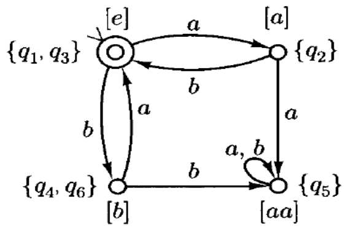
*The minimal DFA for $L = (ab \cup ba)^*$. Each state represents an equivalence class of strings. The start state is $[e]$, which is also an accepting state. Transitions are labeled with input symbols 'a' or 'b*. For instance, from state $[e]$, an 'a' transition leads to $[a]$, and a 'b' transition leads to $[b]$. State $[aa]$ is a non-accepting "trap" state where any further input keeps the machine in that class.*

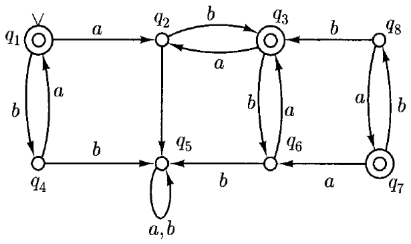

*Figure: A state transition diagram for a DFA M with states q1 through q8. The start state is q1 (indicated by an incoming arrow) and the accepting states are q1, q3, and q7 (indicated by double circles). Transitions include: q1 to q2 on 'a', q1 to q4 on 'b'; q2 to q3 on 'b' and q2 to q5 on 'a'; q3 to q2 on 'a' and q3 to q6 on 'b'; q4 to q1 on 'a' and q4 to q5 on 'b'; q5 has a self-loop on 'a,b'; q6 to q3 on 'a' and q6 to q5 on 'b'; q7 to q6 on 'a' and q7 to q8 on 'b'; q8 to q3 on 'b' and q8 to q7 on 'a'. The diagram visually supports the text by showing that states q7 and q8 are unreachable from the start state q1, while q4 and q6 have identical transition behaviors.*

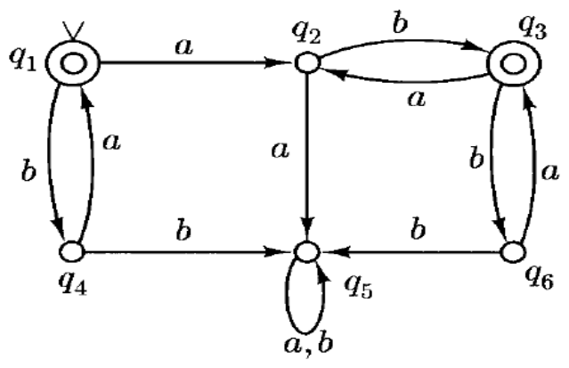

*Figure: A state transition diagram (FSA) with six states labeled q1 through q6. States q1 and q3 are accepting states, indicated by double circles. The start state is q1, indicated by an incoming arrow from nowhere. Transitions: q1 goes to q4 on 'b' and to q2 on 'a'. q4 loops back to q1 on 'a' and goes to q5 on 'b'. q2 goes to q3 on 'b', to q6 on 'a', and to q5 on 'a'. q3 loops back to q2 on 'a' and goes to q6 on 'b'. q5 has a self-loop on 'a,b'. q6 goes to q3 on 'a' and to q5 on 'b'.*

<!-- slides C·4-8 -->
### Algorithm for Constructing Minimal DFAs

To construct a minimal DFA, we must compute the equivalence classes of the relation $\approx_L$. Given a DFA $M = (K, \Sigma, \delta, s, F)$ where $L = L(M)$, we define a relation $A_M \subseteq K \times \Sigma^*$ as follows:
$$(q, w) \in A_M \iff (q, w) \vdash_M^* (f, e) \text{ for some } f \in F$$
Intuitively, $(q, w) \in A_M$ means that the string $w$ drives the machine from state $q$ to an accepting state.

Two states $q, p \in K$ are **equivalent** (denoted $q \equiv p$) if for all strings $z \in \Sigma^*$:
$$(q, z) \in A_M \iff (p, z) \in A_M$$
This means that no string can distinguish between $q$ and $p$; they behave identically with respect to acceptance. States that are equivalent can be merged into a single state in the minimal DFA.

#### Iterative Computation of Equivalence

We compute $\equiv$ as the limit of a sequence of equivalence relations $\equiv_0, \equiv_1, \equiv_2, \dots$.
For two states $q, p \in K$, we define:
$$q \equiv_n p \iff (q, z) \in A_M \iff (p, z) \in A_M \text{ for all strings } z \text{ with } |z| \le n$$
This relation checks if $q$ and $p$ behave identically on all input strings of length up to $n$.

**Base Case ($\equiv_0$):**
The relation $\equiv_0$ depends only on whether states are accepting or non-accepting.
- If $q, p \in F$, then $q \equiv_0 p$.
- If $q, p \notin F$, then $q \equiv_0 p$.
Thus, there are exactly two equivalence classes: the set of accepting states $F$ and the set of non-accepting states $K - F$.

**Refinement Step:**
Each relation $\equiv_n$ is a **refinement** of $\equiv_{n-1}$, meaning it splits classes further but never merges them. To find $\equiv_n$ from $\equiv_{n-1}$, we use the following lemma:
$$q \equiv_n p \iff (a) \ q \equiv_{n-1} p \quad \text{and} \quad (b) \ \forall a \in \Sigma, \ \delta(q, a) \equiv_{n-1} \delta(p, a)$$
Condition (b) ensures that for every input symbol $a$, the states transition to equivalent states under the previous iteration's equivalence.

#### Termination of the Algorithm

The algorithm continues until $\equiv_n$ is identical to $\equiv_{n-1}$, meaning no further splitting occurs.
- For each iteration where $\equiv_n \neq \equiv_{n-1}$, the relation $\equiv_n$ is a proper refinement of $\equiv_{n-1}$.
- This implies that $\equiv_n$ has at least one more equivalence class than $\equiv_{n-1}$.
- Since the number of states in $M$ is finite ($|K|$), the number of equivalence classes cannot exceed $|K|$.
- Therefore, the algorithm must terminate after at most $|K|-1$ steps.

#### Worked Examples

**Example 1: Basic Minimization**
Consider the DFA shown in `assets/C-007-f1.png`.
- **Initial Partition ($\equiv_0$):** We split states into accepting and non-accepting sets.
  - Classes: $\{q_1, q_3\}$ and $\{q_2, q_4, q_5, q_6\}$.

- **Iteration 1 ($\equiv_1$):** We check transitions for each symbol.
  - Split happened because $\delta(q_2, b) \not\equiv_0 \delta(q_4, b)$ and $\delta(q_2, b) \not\equiv_0 \delta(q_5, b)$ and $\delta(q_4, a) \not\equiv_0 \delta(q_5, a)$.
  - New classes: $\{q_1, q_3\}$, $\{q_2\}$, $\{q_4, q_6\}$, $\{q_5\}$.

- **Iteration 2 ($\equiv_2$):** We check transitions again with the new partition.
  - No further splits occur because all transitions from states within a class lead to states in the same target class.
  - The algorithm terminates.

The resulting minimal DFA is shown in `assets/C-007-f2.png`. The states are the equivalence classes: $\{q_1, q_3\}$, $\{q_2\}$, $\{q_4, q_6\}$, and $\{q_5\}$.

**Example 2: Unreachable State**
Consider a DFA with one unreachable state, state D. We remove this state first.
- **Initial Partition ($\equiv_0$):** $\{C\}, \{A,B,E,F,G,H\}$
- **Iteration 1 ($\equiv_1$):** $\{C\}, \{A,E,G\}, \{B,H\}, \{F\}$
- **Iteration 2 ($\equiv_2$):** $\{C\}, \{A,E\}, \{B,H\}, \{G\}, \{F\}$
- After the 3rd iteration there is no splitting of classes, so the algorithm terminates.

The resulting minimal DFA is shown in `assets/C-008-f2.png`. The states are the equivalence classes: $\{A,E\}$, $\{B,H\}$, $\{C\}$, $\{F\}$, and $\{G\}$.

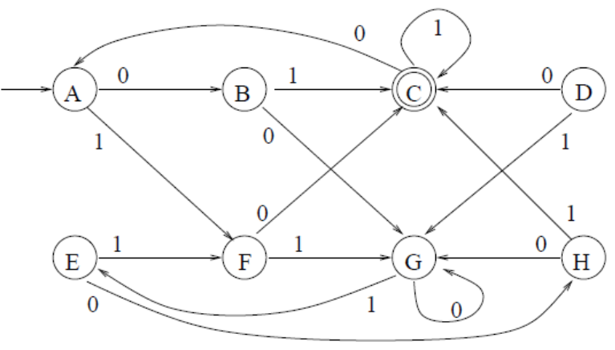

*Figure: The original DFA graph with states A, B, C, D, E, F, G, H. State A is the start state (indicated by an incoming arrow). State C is a final state (double circle). Transitions are labeled 0 or 1: A→B(0), A→F(1), B→C(1), B→G(0), C→A(0), C→C(1), D→C(0), D→H(1), E→F(1), E→E(0), F→C(0), F→G(1), G→C(0), G→G(0), G→E(1), H→C(1), H→G(0). State D is isolated from the start state, illustrating it is unreachable.*

<!-- slides C·9 -->
### Limitations of the Pumping Lemma
The **Pumping Lemma** cannot show a language is regular. A language can satisfy all conditions yet remain non-regular.

Consider:
$$ L = \{a^i b^j c^j : i \geq 1, j \geq 0\} \cup \{b^j c^k : j, k \geq 0\} $$
$L$ is **not regular**, but the conclusion of the Pumping Lemma is true for $L$.

> **Key idea:** Satisfying the lemma is necessary but not sufficient for regularity.

##### Check your understanding

1. Can the Pumping Lemma prove a language is regular?
<details><summary>Answer</summary>

No. It only proves non-regularity. A language may satisfy conditions and still be non-regular (e.g., $L$).

</details>

---
**End of Chapter 2 Summary:** We explored DFA minimization via equivalence classes and the Myhill-Nerode Theorem, learned the minimal DFA construction algorithm, and discovered Pumping Lemma limitations. This completes our study of FSA minimization and regular language properties.

---

## Chapter 3 · Context-Free Grammars and Parse Trees

*Slides D·1–F·6 (lecture-cfg_1_class.pdf, lecture-cfg_2_class.pdf, lecture-cfg_3_19.pdf)*

This chapter introduces Context-Free Grammars (CFGs) as a formal mechanism for defining languages with recursive structures, such as balanced parentheses and palindromes. It covers the formal definition of CFGs, the concept of derivations, and how different derivation orders can represent the same syntactic structure. Finally, it establishes Parse Trees as a canonical representation that abstracts away the order of rule applications to show the hierarchical structure of generated strings.

*3 recap slide(s) here repeat material covered in [Chapter 1 · Non-Regular Languages and Pumping Lemma](#chapter-1--non-regular-languages-and-pumping-lemma).*

<!-- slides D·2-5 -->
### Introduction to Context-Free Grammars

We begin by observing a pattern in the regular expression $a(a^* \cup b^*)a$. Any string in this language has a leading $a$, a middle part generated by $(a^* \cup b^*)$, and a trailing **$b$**. We can model this structure using symbols: let $S$ represent the entire string and $M$ represent the middle part. This observation yields our first **rule**:
$$S \rightarrow aMb$$
Here, the arrow $\rightarrow$ is read as "can be." It defines how a symbol can be replaced by a sequence of other symbols.

To define the middle part $M$, we note it must be either a string of only $a$'s or a string of only $b$'s. We introduce new symbols $A$ and $B$ to represent these strings, adding the rules:
$$M \rightarrow A \quad \text{and} \quad M \rightarrow B$$

Now we define what constitutes a string of $a$'s ($A$). It can be the **empty string** (denoted $\epsilon$) or a leading $a$ followed by another string of $a$'s. This recursive definition is captured by:
$$A \rightarrow \epsilon \quad \text{and} \quad A \rightarrow aA$$
Similarly, for strings of $b$'s ($B$):
$$B \rightarrow \epsilon \quad \text{and} \quad B \rightarrow bB$$

Combining these, we get a **language generator** that defines the class of languages with recursive structure. The full set of rules is:
$$
\begin{aligned}
S &\rightarrow aMb \\
M &\rightarrow A, \ M \rightarrow B \\
A &\rightarrow \epsilon, \ A \rightarrow aA \\
B &\rightarrow \epsilon, \ B \rightarrow bB
\end{aligned}
$$
This definition is **non-deterministic** because at step $M$, the system can choose to generate either $a$'s or $b$'s.

Formally, a **Context-Free Grammar (CFG)** $G$ is defined as a quadruple $(V, \Sigma, R, S)$:
1.  **$V$**: A finite set of symbols called the **alphabet**.
2.  **$\Sigma$**: The set of **terminals**, which are the actual characters in the language strings ($\Sigma \subseteq V$).
3.  **$S$**: The **start symbol**, a specific element in $V$ that is not a terminal ($S \in V - \Sigma$).
4.  **$R$**: A finite set of **rules** (or productions), where each rule maps a non-terminal to a string of symbols.

The symbols in $V - \Sigma$ are called **non-terminals**. They act as placeholders that must eventually be replaced by terminals to form a valid string. If a pair $(A, u)$ is in the set of rules $R$, we write it as:
$$A \xrightarrow{G} u$$
This notation indicates that the non-terminal $A$ can be rewritten as the string $u$ according to grammar $G$.

<!-- slides D·6-8, E·5, E·7-8 -->
### Derivations and Context-Free Languages

To define what a **context-free grammar** (CFG) generates, we need a formal way to describe string construction. A **derivation** is a sequence of steps transforming a start symbol into a terminal string.

#### The Derivation Relation
For any CFG $G$, the one-step derivation relation $\Rightarrow_G$ is defined as: $u \Rightarrow_G v$ if there exist $x, y \in V^*$ and a variable $A \in V - \Sigma$ such that:
$$ u = xAy, \quad v = xv'y, \quad \text{and} \quad A \to_G v' $$
Here, $A \to_G v'$ is a production rule. We replace a single variable $A$ in $u$ with $v'$ to get $v$, leaving $x$ and $y$ unchanged.

The relation $\Rightarrow_G^*$ is the **reflexive transitive closure** of $\Rightarrow_G$:
1.  **Reflexive:** $w \Rightarrow_G^* w$ (zero steps).
2.  **Transitive:** If $u \Rightarrow_G^* v$ and $v \Rightarrow_G^* w$, then $u \Rightarrow_G^* w$.

A **derivation** of $w_n$ from $w_0$ is a sequence:
$$ w_0 \Rightarrow_G w_1 \Rightarrow_G \dots \Rightarrow_G w_n $$
where each step applies one production rule. The number of steps is $n$.

The **language generated by G**, denoted $L(G)$, is the set of all terminal strings derived from the start symbol $S$:
$$ L(G) = \{ w \in \Sigma^* : S \Rightarrow_G^* w \} $$
A language $L$ is a **context-free language** (CFL) if there exists a CFG $G$ such that $L = L(G)$.

#### Example: The Language $\{a^n b^n\}$
Consider $L = \{a^n b^n : n \geq 0\}$. We generate this with $G = (V, \Sigma, R, S)$ where:
*   $V = \{S, a, b\}$
*   $\Sigma = \{a, b\}$
*   $R$: $S \to \epsilon$ and $S \to aSb$.

To derive $a^2 b^2$ ($aabb$):
1.  Start with $S$.
2.  Apply $S \to aSb$: $S \Rightarrow aSb$.
3.  Apply $S \to aSb$ to the inner $S$: $aSb \Rightarrow aaSbb$.
4.  Apply $S \to \epsilon$: $aaSbb \Rightarrow aabb$.

The derivation is:
$$ S \Rightarrow aSb \Rightarrow aaSbb \Rightarrow aabb $$
This shows $aabb \in L(G)$. The notation $S \to \epsilon \mid aSb$ is shorthand for the two rules.

#### Example: Balanced Parentheses
Consider balanced parentheses like `()(( ))`. Define $G = (V, \Sigma, R, S)$ where:
*   $V = \{S, (, )\}$
*   $\Sigma = \{(, )\}$
*   Rules $R$: $S \to \epsilon$, $S \to SS$, and $S \to (S)$.

To derive `()(( ))`:
1.  Start with $S$.
2.  Apply $S \to SS$: $S \Rightarrow SS$.
3.  Apply $S \to (S)$ to the second $S$: $SS \Rightarrow S(S)$.
4.  Apply $S \to (S)$ to the inner $S$: $S(S) \Rightarrow S((S))$.
5.  Apply $S \to \epsilon$ to the innermost $S$: $S((S)) \Rightarrow S(( ))$.
6.  Apply $S \to (S)$ to the first $S$: $S(( )) \Rightarrow (S)(())$.
7.  Apply $S \to \epsilon$ to the remaining $S$: $(S)(()) \Rightarrow ()(( ))$.

The full derivation is:
$$ S \Rightarrow SS \Rightarrow S(S) \Rightarrow S((S)) \Rightarrow S(( )) \Rightarrow (S)(()) \Rightarrow ()(( )) $$
This demonstrates how recursive rules generate nested structures.

#### Union of Context-Free Languages
CFLs are closed under union. If $L_1$ and $L_2$ are CFLs, then $L = L_1 \cup L_2$ is a CFL.

Consider $L = \{a^n b^n : n \geq 0\} \cup \{b^n a^n : n \geq 0\}$. Let $L_1 = \{a^n b^n\}$ and $L_2 = \{b^n a^n\}$. To construct a grammar for their union, create a new start symbol $S$ branching to the start symbols of $L_1$ and $L_2$.

Let $G = (V, \Sigma, R, S)$ where:
*   $V = \{S, S_1, S_2, a, b\}$
*   $\Sigma = \{a, b\}$
*   Rules $R$:
    *   $S \to S_1$
    *   $S \to S_2$
    *   $S_1 \to \epsilon$, $S_1 \to a S_1 b$ (generates $L_1$)
    *   $S_2 \to \epsilon$, $S_2 \to b S_2 a$ (generates $L_2$)

To generate $aabb$, use $S \to S_1$. To generate $ba$, use $S \to S_2$.

#### Generating All Strings
Consider the regular language $L = \{a, b\}^*$. One grammar is:
*   $V = \{S, a, b\}$
*   $\Sigma = \{a, b\}$
*   Rules: $S \to \epsilon$, $S \to Sa$, $S \to Sb$.

This builds strings by appending characters. Alternatively, we can define it recursively from both ends or via concatenation:
*   Rules: $S \to \epsilon$, $S \to a$, $S \to b$, $S \to SS$.

Both grammars generate $\{a, b\}^*$, showing a single language can have multiple equivalent grammars.

#### Palindromes and Non-Palindromes
The language of palindromes over $\{a, b\}$ includes strings reading the same forwards and backwards (including $\epsilon$). A grammar is:
$$ S \to \epsilon \mid a \mid b \mid aSa \mid bSb $$
This captures that a palindrome is empty, a single character, or a character surrounding a smaller palindrome.

Consider the complement $L'$, the set of **non-palindromes**. For regular languages, the complement is always regular. However, for CFLs, the complement is not necessarily a CFL. This highlights a limitation of CFGs compared to regular expressions.

<!-- slides E·9-10 -->
### Regular Languages and Non-Palindromes

To generate all **non-palindromes** over $\{a, b\}$, define a **context-free grammar** $L'$. Since adding matching characters preserves non-palindrome status ($S \to aSa \mid bSb$), we also handle differing outer characters: for any string $A$, $aAb$ and $bAa$ are non-palindromes. Thus, add rules:
$$ S \to aAb \mid bAa $$
Non-terminal $A$ generates any string (including $e$):
$$ A \to Aa \mid Ab \mid e $$
This proves the complement of palindromes is context-free; **context-free languages** are not closed under complement.

Every **regular language** is a **context-free language**. Given a **DFA** $M = (K, \Sigma, \delta, s, F)$, construct grammar $G = (V, \Sigma, R, S)$. Non-terminals $V$ are states $K$ plus $\Sigma$; start symbol $S$ is the DFA's start state. Rules $R$:
1. For $\delta(q, a) = p$, add $q \to ap$.
2. For $q \in F$, add $q \to e$.

This conversion maps DFA paths to grammar derivations, proving $L(G) = L(M)$.

> **Beyond the slides:** The grammar simulates the DFA from start to accept state. While proving regular languages are a subset of CFLs, it does not produce the minimal grammar for $L$.

<!-- slides E·11-17, F·6 -->
### Parse Trees and Equivalent Derivations

Consider the CFG for the properly balanced left & right parentheses: $S \to e$, $S \to SS$, $S \to (S)$. Consider the string $( )( )$. This can be derived as:
$S \Rightarrow SS \Rightarrow (S)S \Rightarrow ( )S \Rightarrow ( )(S) \Rightarrow ( )( )$
It can also be derived as:
$S \Rightarrow SS \Rightarrow S(S) \Rightarrow S( ) \Rightarrow (S)( ) \Rightarrow ( )( )$

Observe:
- In these two derivations, the rules applied at each step are same.
- Except the difference is in the order in which the rules are applied.

We can view both derivations as a parse tree. The points are called nodes. The topmost node is called the root. The nodes along the bottom are called leaves. By concatenating the labels of the leaves from left to right, we obtain the derived string, which is called the yield of the parse tree.

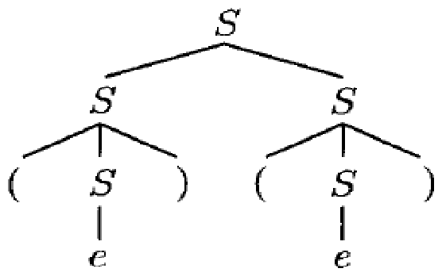

In this diagram, the root node at the top is labeled 'S'. It branches down to two child nodes, both also labeled 'S'. Each of these 'S' nodes further branches to three children: a left parenthesis '(', a middle 'S' node, and a right parenthesis ')'. Finally, each of the lower 'S' nodes connects to a single leaf node labeled 'e'. The leaves from left to right are '(', 'e', ')', '(', 'e', ')'.

Parse trees are ways of representing derivations so that the superficial differences between derivations (because of order of applications of rules) are suppressed. Parse Tree represent equivalent derivations.

#### Formal Definition of Parse Trees

Formally, for an arbitrary CFG $G = \{V, \Sigma, R, S\}$, we define its parse trees and their roots, leaves, and yields, as follows:

1.  For each $a \in \Sigma$, this is a parse tree. The single node of this parse tree is the root and a leaf. The yield of this parse tree is $a$.
2.  If $A \to e$ is a rule in $R$, then a tree with root $A$ connected to a leaf $e$ is a parse tree; its root is the node labeled $A$, its sole leaf is the node labeled $e$, and its yield is $e$.

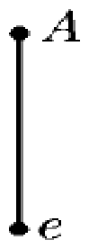

3.  If $T_1, \dots, T_n$ are parse trees, where $n \ge 1$, with roots labeled $A_1, A_2, \dots, A_n$ respectively and with yields $y_1, y_2, \dots, y_n$, and $A \to A_1 A_2 \dots A_n$ is a rule in $R$, then a new tree is a parse tree. Its root is the new node labeled $A$, its leaves are the leaves of $T_1, T_2, \dots, T_n$ and the yield is $y_1 y_2 \dots y_n$.

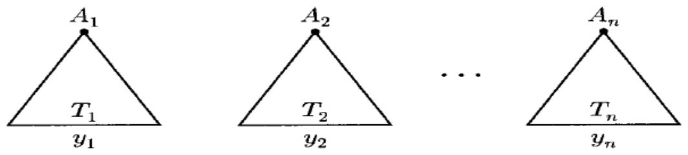
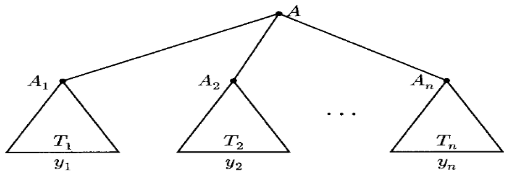

#### Equivalent Derivations

We say that $D$ precedes $D'$ denoted $D < D'$ if $n > 2$ and there is an integer $k$, $1 < k < n$ such that:
1.  For all $i \neq k$ we have $x_i = x'_i$.
2.  $x_{k-1} = x'_{k-1} = uAvBw$ where $u, v, w \in V^*$ and $A, B \in V - \Sigma$.
3.  $x_k = uyvBw$, where $A \to y \in R$.
4.  $x'_k = uAvzw$, where $B \to z \in R$.
5.  $x_{k+1} = x'_{k+1} = uyvzw$.

Example: Consider the three derivations $D_1, D_2, D_3$ then $D_1 < D_2$, $D_2 < D_3$. However, $D_1$ does not precede $D_3$.

We say two derivations $D$ and $D'$ are similar if they belong in the reflexive, transitive closure of $<$.

**Leftmost Derivation**
Repeatedly replace the leftmost nonterminal in the current string according to the rule suggested by the parse tree. It is not preceded by any other derivation.

**Rightmost Derivation**
Repeatedly replace the rightmost nonterminal in the current string according to the rule suggested by the parse tree. It does not precede any other derivation.

> **Beyond the slides:**
> The precedence relation $D < D'$ specifically captures the "swapping" of independent derivations (where two nonterminals are expanded in different orders). This is why the example shows $D_1 < D_2$ and $D_2 < D_3$, but not $D_1 < D_3$ directly; they are connected via transitivity.

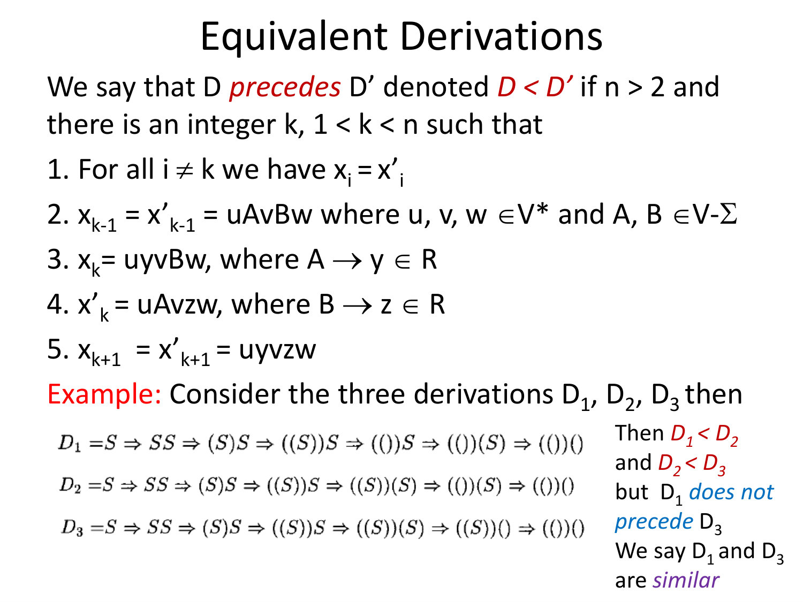

*Figure: A visual example comparing three derivation sequences labeled D_1, D_2, and D_3. Each sequence starts with S and proceeds through a series of steps using the implication arrow (\Rightarrow) to show the transformation of strings involving parentheses and S. The text on the right explains the relationships: D_1 precedes D_2 (D_1 < D_2), and D_2 precedes D_3 (D_2 < D_3). However, it notes that D_1 does not precede D_3, concluding that D_1 and D_3 are 'similar'.*

##### Check your understanding

1.  Explain why the two different derivations for $( )( )$ shown are considered equivalent.
    <details><summary>Answer</summary>

    They are equivalent because they result in the same parse tree. The rules applied at each step are identical; only the order of application differs. One derivation expands the left $S$ first, while the other expands the right $S$ first, but both yield the string $( )( )$.

    </details>

2.  If derivation $D_1$ precedes $D_2$, and $D_2$ precedes $D_3$, are $D_1$ and $D_3$ similar?
    <details><summary>Answer</summary>

    Yes. Similarity is defined by the reflexive, transitive closure of the precedence relation. Since there is a chain of precedence steps connecting $D_1$ to $D_3$ (via $D_2$), they are similar even if $D_1$ does not directly precede $D_3$.

    </details>

---

## Chapter 4 · Ambiguity in Context-Free Grammars and Properties of Context-Free Languages

*Slides F·7–G·6 (lecture-cfg_3_19.pdf, lecture-cfg_4_20.pdf)*

*4 recap slide(s) here repeat material covered in [Chapter 1 · Non-Regular Languages and Pumping Lemma](#chapter-1--non-regular-languages-and-pumping-lemma), [Chapter 3 · Context-Free Grammars and Parse Trees](#chapter-3--context-free-grammars-and-parse-trees).*

<!-- slides F·10-17, G·4-6 -->
A **Context-Free Grammar (CFG)** is a set of rules for generating strings. A grammar is **ambiguous** if at least one string has multiple distinct **parse trees**, creating structural uncertainty.

### Ambiguous Grammars
Consider a CFG for algebraic expressions with operators $+$, $*$, parentheses, and identifier $id$:
$$ E \rightarrow id \mid E + E \mid E * E \mid (E) $$
This grammar allows two parse trees for $id + id * id$.

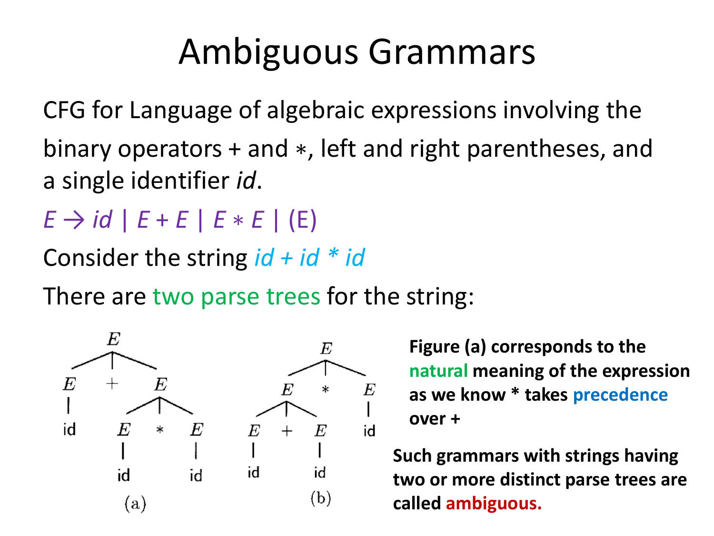

Figure (a) groups multiplication first: $(id + (id * id))$, matching standard **precedence** where $*$ overrides $+$.

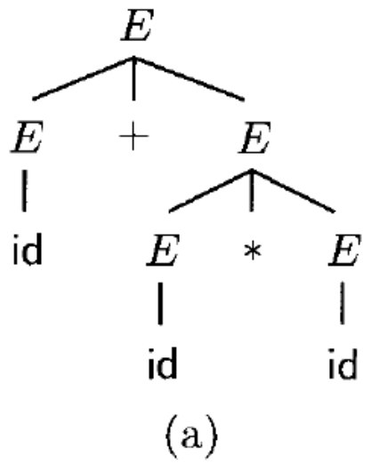

Figure (b) groups addition first: $((id + id) * id)$. Since the string has two distinct parse trees, the grammar is **ambiguous**. This prevents compilers from determining the correct structure without extra rules.

### Unambiguous Grammars
To resolve ambiguity, we enforce precedence and associativity using non-terminals $T$ (**term**) and $F$ (**factor**).

1.  **Expressions ($E$):** An expression is a sum of terms. Replacing $E \rightarrow E + E$ with $E \rightarrow E + T$ ensures addition occurs at the top level after multiplications are resolved.
    $$ E \rightarrow E + T \mid T $$
2.  **Terms ($T$):** A term is a product of factors.
    $$ T \rightarrow T * F \mid F $$
3.  **Factors ($F$):** A factor is an identifier or parenthesized expression.
    $$ F \rightarrow (E) \mid id $$

This hierarchy enforces evaluation order: factors, then terms, then expressions. It also ensures left-associativity (e.g., $id + id + id$ parses as $(id + id) + id$). The **final grammar** is:
$$ E \rightarrow E + T \mid T $$
$$ T \rightarrow T * F \mid F $$
$$ F \rightarrow (E) \mid id $$

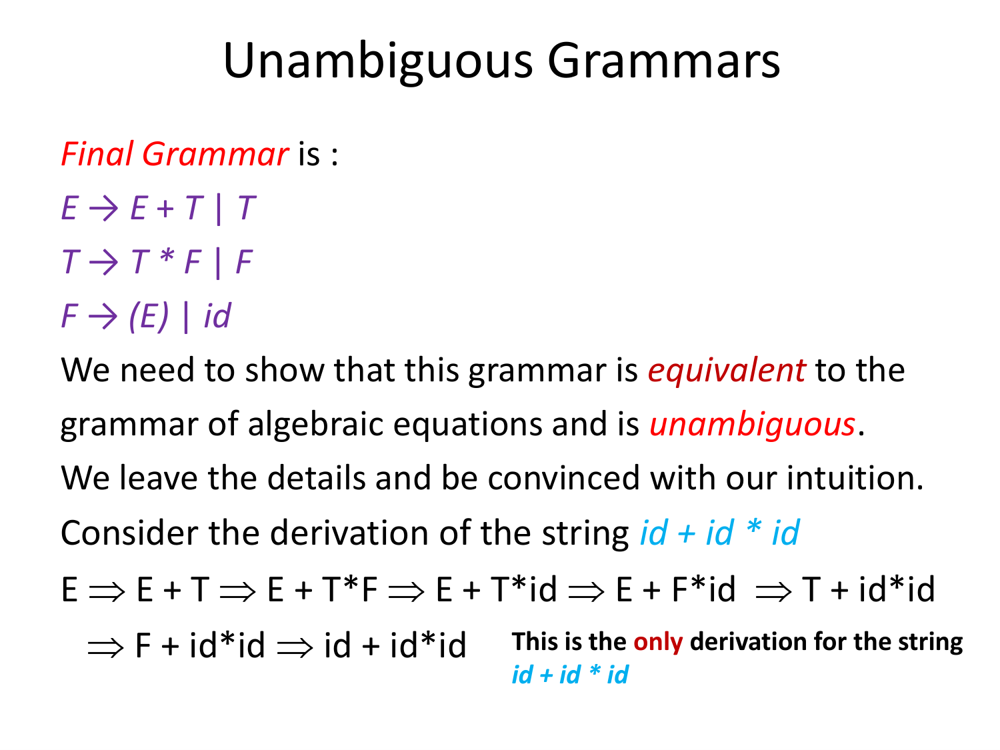

Deriving $id + id * id$ yields a unique sequence:
$$ E \Rightarrow E + T \Rightarrow E + T*F \Rightarrow E + T*id \Rightarrow E + F*id \Rightarrow T + id*id \Rightarrow F + id*id \Rightarrow id + id*id $$
The unique derivation confirms the grammar is **unambiguous**.

### Ambiguity: The Dangling Else Problem
Ambiguity often appears in programming syntax, such as the "dangling else" in C-like languages. Consider `if (e1) if (e2) f(); else g();`.

Grammar rules:
$$ S \rightarrow \text{if } (E) S \mid \text{if } (E) S \text{ else } S \mid OS $$
This allows two interpretations of the `else`:
1.  **Correct:** The `else` matches the inner `if`. Structure: `if (e1) { if (e2) f(); else g(); }`.
2.  **Incorrect:** The `else` matches the outer `if`. Structure: `if (e1) { if (e2) f(); } else g();`.

To resolve this, split $S$ into $S_1$ (with `else`) and $S_2$ (without):
$$ S \rightarrow S_1 \mid S_2 $$
$$ S_1 \rightarrow \text{if } (E) \, S_1 \text{ else } S_1 \mid OS $$
$$ S_2 \rightarrow \text{if } (E) \, S \mid \text{if } (E) \, S_1 \text{ else } S_2 $$
This forces the parser to associate `else` with the closest unmatched `if`.

### Computational Problems and Inherent Ambiguity
Fundamental limits exist for resolving ambiguity:
*   **Problem 1:** Given a CFG $G$, find an unambiguous grammar $G'$ for the same language. No general algorithm exists.
*   **Problem 2:** Given a CFG $G$, determine if it is ambiguous. This problem is **undecidable**; no algorithm can answer "yes" or "no" for all inputs.
*   **Problem 3:** Is every context-free language generable by an unambiguous grammar? No. Some languages are **inherently ambiguous**.

A language $L$ is **inherently ambiguous** if *every* grammar generating $L$ is ambiguous. Example:
$$ L = \{a^n b^n c^m d^m \mid n \ge 1, m \ge 1\} \cup \{a^n b^m c^m d^n \mid n \ge 1, m \ge 1\} $$
Here, the parser cannot distinguish whether $b$'s and $c$'s pair based on the first or second part of the string. Practical languages avoid inherent ambiguity.

### Properties of Context-Free Languages
**Context-Free Languages (CFL)** are closed under Union, Concatenation, and Kleene Star. If $L_1$ and $L_2$ are CFLs, the results are also CFLs.

**1. Union ($L_1 \cup L_2$)**
Introduce a new start symbol $S$ deriving $S_1$ or $S_2$.
$$ G = (V_1 \cup V_2 \cup \{S\}, \Sigma_1 \cup \Sigma_2, R, S) $$
$$ R = R_1 \cup R_2 \cup \{S \rightarrow S_1, S \rightarrow S_2\} $$

**2. Concatenation ($L_1 L_2$)**
The new start symbol derives $S_1$ followed by $S_2$.
$$ R = R_1 \cup R_2 \cup \{S \rightarrow S_1 S_2\} $$

**3. Kleene Star ($L_1^*$)**
The new start symbol derives $\epsilon$ (or $e$) or a sequence starting with $S_1$.
$$ R = R_1 \cup \{S \rightarrow e, S \rightarrow SS_1\} $$

#### Check your understanding
1.  Why is the grammar $E \rightarrow E + E \mid E * E \mid id$ considered ambiguous for the string $id + id * id$?
2.  What is the fundamental difference between a grammar that is "ambiguous" and a language that is "inherently ambiguous"?

<details><summary>Answer</summary>

1. It is ambiguous because the string has two distinct parse trees: one where multiplication happens first (matching standard precedence) and one where addition happens first. The grammar rules do not enforce an order of operations.
2. An **ambiguous grammar** is a specific set of rules allowing multiple derivations; it might be rewritten to remove ambiguity. A language is **inherently ambiguous** if *every* possible grammar generating that language is ambiguous, meaning no unambiguous version exists.

</details>

<!-- slides C·9-10 -->

## Formatting sample: code, callouts and tables

A DFA can be simulated in a few lines. The same idea in two languages (tabs appear when fences carry `tab="…"`):

```python tab="Python"
def accepts(delta, start, finals, w):
    q = start
    for ch in w:
        q = delta[(q, ch)]
    return q in finals
```

```c tab="C"
int accepts(int delta[][2], int start, const int *finals, const char *w) {
    int q = start;
    for (; *w; w++) q = delta[q][*w - '0'];
    return finals[q];
}
```

> **Key idea:** a DFA reads each symbol exactly once, so simulating it takes time linear in $|w|$.

### Complexity at a glance

| Machine | Memory | Decides |
|---|---|---|
| DFA | finite states | regular languages |
| PDA | stack | context-free languages |

### A plain block

```
q0 --0--> q1 --1--> q0
```

