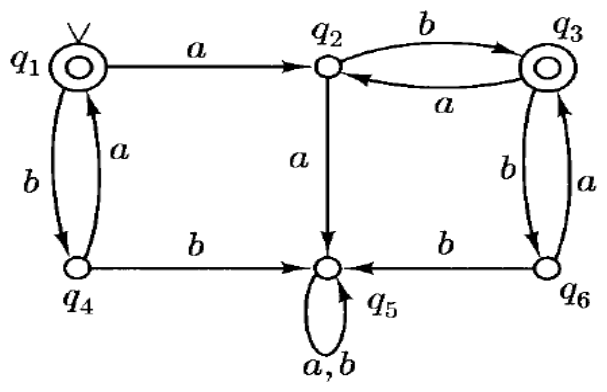

# toc

> **Level:** Summary · **Sources:** **A** = PowerPoint Presentation, **B** = PowerPoint Presentation, **C** = PowerPoint Presentation, **D** = PowerPoint Presentation, **E** = PowerPoint Presentation, **F** = PowerPoint Presentation, **G** = PowerPoint Presentation

These notes are organised by chapter:

- [Chapter 1 · Non-Regular Languages and Pumping Lemma](#chapter-1--non-regular-languages-and-pumping-lemma)
- [Chapter 2 · FSA Minimization and Myhill-Nerode Theorem](#chapter-2--fsa-minimization-and-myhill-nerode-theorem): This chapter covers the theory and algorithms for minimizing Deterministic Finite Automata (DFAs) to their smallest equivalent form.
- [Chapter 3 · Context-Free Grammars and Parse Trees](#chapter-3--context-free-grammars-and-parse-trees): This chapter introduces Context-Free Grammars (CFGs) as a formal mechanism for defining languages with recursive structures, such as balanced parentheses and palindromes.
- [Chapter 4 · Ambiguity in Context-Free Grammars and Properties of Context-Free Languages](#chapter-4--ambiguity-in-context-free-grammars-and-properties-of-context-free-languages)

> **Key takeaways**
>
> - **Regular languages** are recognized by FSAs or generated by regex and possess memory independent of string length.
> - The **Pumping Lemma** provides a necessary condition for regularity where any sufficiently long string in a regular language can be decomposed into $xyz$ such that repeating the middle section $y$ keeps the string within the language.
> - **State minimization** simplifies a DFA by removing unreachable states and merging equivalent states while preserving the accepted language.
> - The **Myhill-Nerode Theorem** establishes that a minimal DFA exists with exactly one state per equivalence class of indistinguishable strings, where the number of such classes serves as a lower bound on the number of states.
> - The algorithm for constructing minimal DFAs iteratively splits states into equivalence classes based on their transitions until no further distinctions can be made.
> - **Context-Free Grammars** generate languages through rules that rewrite non-terminals into terminals, allowing for non-deterministic choices during derivation.
> - A language is a **CFL** if it can be generated by some CFG, and while CFLs are closed under union, concatenation, and Kleene star, they are not closed under complement.
> - **Ambiguous grammars** allow multiple distinct parse trees for the same string, whereas unambiguous grammars enforce unique derivations to resolve structural issues like precedence or the dangling else problem.

## Contents

- [Chapter 1 · Non-Regular Languages and Pumping Lemma](#chapter-1--non-regular-languages-and-pumping-lemma)
- [Chapter 2 · FSA Minimization and Myhill-Nerode Theorem](#chapter-2--fsa-minimization-and-myhill-nerode-theorem)
- [Chapter 3 · Context-Free Grammars and Parse Trees](#chapter-3--context-free-grammars-and-parse-trees)
- [Chapter 4 · Ambiguity in Context-Free Grammars and Properties of Context-Free Languages](#chapter-4--ambiguity-in-context-free-grammars-and-properties-of-context-free-languages)

---

## Chapter 1 · Non-Regular Languages and Pumping Lemma

*Slides A·1–A·8 (lecture-13_Class.pdf)*

<!-- slides A·2-8 -->
- **Regular languages**: Sets recognized by FSAs or generated by regex; memory independent of string length.
- **Non-regular examples**: $\{0^n 1^n\}$ (FSA cannot count), $\{1^p : p \text{ is prime}\}$ (no repetitive structure).
- **Pumping Lemma**: For regular $L$, $\exists n \geq 1$ s.t. $\forall w \in L, |w| \geq n$, $w=xyz$ where:
    1. $y \neq \epsilon$
    2. $|xy| \leq n$
    3. $xy^i z \in L \; \forall i \geq 0$
- **Proof strategy**: Assume $L$ regular, choose specific $w$, decompose per lemma, pump to derive contradiction (e.g., $xz = 0^{n-r}1^n \notin L$).
- **Closure property**: If $L$ were regular, $L \cap 0^*1^* = \{0^n 1^n\}$ would be regular; since $\{0^n 1^n\}$ is not, $L$ (equal 0s/1s) is not.
- **Palindrome ($ww$)**: Pumping $w=0^n 1 0^n 1$ creates mismatched halves ($0^{n+r} \dots 0^n$), violating form $ww$.

---

## Chapter 2 · FSA Minimization and Myhill-Nerode Theorem

*Slides B·1–C·9 (lecture-15_class.pdf, lecture-16.pdf)*

This chapter covers the theory and algorithms for minimizing Deterministic Finite Automata (DFAs) to their smallest equivalent form. It introduces the concept of indistinguishable states and equivalence relations, culminating in the Myhill-Nerode Theorem which establishes a fundamental link between regular languages and finite equivalence classes. Finally, it details a constructive algorithm to compute the minimal DFA from any given DFA.

*2 recap slide(s) here repeat material covered in [Chapter 1 · Non-Regular Languages and Pumping Lemma](#chapter-1--non-regular-languages-and-pumping-lemma).*

<!-- slides B·2-8, C·2 -->
### Introduction to State Minimization
- **State minimization** simplifies a DFA by removing unreachable states and merging equivalent states while preserving the accepted language.
- **Unreachable states** have no path from the start state; they must be removed first as they cannot be accessed during computation.
- Two strings $x, y$ are **indistinguishable** ($x \approx_L y$) if $\forall z \in \Sigma^*, xz \in L \iff yz \in L$; otherwise they are **distinguishable**.
- In a DFA $M$, $x \sim_M y$ if both drive the machine from start state $s$ to the same state $q$; $\sim_M$ is a refinement of $\approx_L$.
- The number of equivalence classes under $\approx_L$ is a **lower bound** on the number of states for any DFA accepting $L$.
- **Myhill-Nerode Theorem**: A minimal DFA exists with exactly one state per equivalence class of $\approx_L$, where transitions are defined by $\delta([x], a) = [xa]$.
- For $L = (ab \cup ba)^*$, the minimal DFA has 4 states: $[e]$ (start/accepting), $[a]$, $[b]$, and $[aa]$ (trap).

<!-- slides C·4-8 -->
### Algorithm for Constructing Minimal DFAs
- **Equivalence ($q \equiv p$):** States are equivalent if $\forall z \in \Sigma^*, (q, z) \in A_M \iff (p, z) \in A_M$, meaning no string distinguishes them.
- **Iterative Definition:** $q \equiv_n p \iff q \equiv_{n-1} p \land \forall a \in \Sigma, \delta(q, a) \equiv_{n-1} \delta(p, a)$.
- **Base Case ($\equiv_0$):** Splits states into two classes: accepting $F$ and non-accepting $K - F$.
- **Termination:** Algorithm stops when $\equiv_n = \equiv_{n-1}$; guaranteed within $|K|-1$ steps as each split increases class count.
- **Preprocessing:** Remove unreachable states before minimization to reduce effort and ensure standard minimal DFA form.

<!-- slides C·9 -->
### Limitations of the Pumping Lemma
- **Pumping Lemma:** Necessary but not sufficient condition for regularity; cannot prove a language is regular.
- **Non-regular counterexample:** $L = \{a^i b^j c^j : i \geq 1, j \geq 0\} \cup \{b^j c^k : j, k \geq 0\}$ satisfies the lemma yet is non-regular.
- **Usage:** Only proves non-regularity; satisfying conditions does not imply regularity.

---

## Chapter 3 · Context-Free Grammars and Parse Trees

*Slides D·1–F·6 (lecture-cfg_1_class.pdf, lecture-cfg_2_class.pdf, lecture-cfg_3_19.pdf)*

This chapter introduces Context-Free Grammars (CFGs) as a formal mechanism for defining languages with recursive structures, such as balanced parentheses and palindromes. It covers the formal definition of CFGs, the concept of derivations, and how different derivation orders can represent the same syntactic structure. Finally, it establishes Parse Trees as a canonical representation that abstracts away the order of rule applications to show the hierarchical structure of generated strings.

*3 recap slide(s) here repeat material covered in [Chapter 1 · Non-Regular Languages and Pumping Lemma](#chapter-1--non-regular-languages-and-pumping-lemma).*

<!-- slides D·2-5 -->
### Introduction to Context-Free Grammars
- **CFG:** Defined as quadruple $(V, \Sigma, R, S)$ where $V$ is alphabet, $\Sigma \subseteq V$ are terminals, $S \in V-\Sigma$ is start symbol, and $R$ is set of rules.
- **Non-terminals:** Symbols in $V - \Sigma$ acting as placeholders rewritten via rules until only terminals remain.
- **Rule notation:** $A \xrightarrow{G} u$ indicates non-terminal $A$ rewrites to string $u$ under grammar $G$.
- **Example generator:** $S \rightarrow aMb$, $M \rightarrow A|B$, $A \rightarrow \epsilon|aA$, $B \rightarrow \epsilon|bB$.
- **Non-determinism:** System can choose between alternatives (e.g., $M \rightarrow A$ or $M \rightarrow B$).

<!-- slides D·6-8, E·5, E·7-8 -->
### Derivations and Context-Free Languages

- **Derivation:** Sequence of steps transforming start symbol $S$ into terminal string via one-step relation $u \Rightarrow_G v$ (replace variable $A$ in $xAy$ with $v'$ using $A \to v'$).
- **Reflexive Transitive Closure ($\Rightarrow_G^*$):** Zero steps ($w \Rightarrow_G^* w$) or transitive chain ($u \Rightarrow_G^* v \land v \Rightarrow_G^* w \implies u \Rightarrow_G^* w$).
- **Language Generated:** $L(G) = \{ w \in \Sigma^* : S \Rightarrow_G^* w \}$; a language is a **CFL** if $L = L(G)$ for some CFG.
- **Union Closure:** If $L_1, L_2$ are CFLs, $L_1 \cup L_2$ is CFL via new start $S \to S_1 \mid S_2$.
- **Multiple Grammars:** Single language (e.g., $\{a,b\}^*$ or palindromes) can have multiple equivalent grammars.
- **Complement Limitation:** Complement of a CFL is not necessarily a CFL (unlike regular languages).

<!-- slides E·9-10 -->
### Regular Languages and Non-Palindromes
- **Non-palindromes** are context-free via grammar: $S \to aAb \mid bAa$ where $A \to Aa \mid Ab \mid e$.
- **Context-free languages** are not closed under complement.
- **Regular languages** are a subset of **context-free languages**.
- **DFA-to-Grammar conversion**: For $\delta(q, a) = p$, add $q \to ap$; for $q \in F$, add $q \to e$.
- This mapping proves $L(G) = L(M)$ by simulating DFA paths.

<!-- slides E·11-17, F·6 -->
### Parse Trees and Equivalent Derivations
- **Parse tree:** Graphical representation of a derivation where the root is labeled $S$, leaves are terminals, and concatenating leaves left-to-right yields the derived string.
- **Equivalent derivations:** Different rule application orders that produce the same parse tree; superficial differences in order are suppressed.
- **Formal construction:** A single terminal node is a tree; if $A \to e$ exists, a root $A$ with leaf $e$ is a tree; if $T_1 \dots T_n$ have roots $A_1 \dots A_n$ and rule $A \to A_1 \dots A_n$ exists, a new root $A$ combining them is a tree.
- **Precedence ($D < D'$):** Derivation $D$ precedes $D'$ if they differ only by swapping the expansion of two independent nonterminals at step $k$.
- **Similarity:** Two derivations are similar if one can reach the other via the reflexive, transitive closure of the precedence relation.
- **Leftmost derivation:** Repeatedly replaces the leftmost nonterminal; it is not preceded by any other derivation.
- **Rightmost derivation:** Repeatedly replaces the rightmost nonterminal; it does not precede any other derivation.

---

## Chapter 4 · Ambiguity in Context-Free Grammars and Properties of Context-Free Languages

*Slides F·7–G·6 (lecture-cfg_3_19.pdf, lecture-cfg_4_20.pdf)*

*4 recap slide(s) here repeat material covered in [Chapter 1 · Non-Regular Languages and Pumping Lemma](#chapter-1--non-regular-languages-and-pumping-lemma), [Chapter 3 · Context-Free Grammars and Parse Trees](#chapter-3--context-free-grammars-and-parse-trees).*

<!-- slides F·10-17, G·4-6 -->
- **Ambiguous Grammar:** A CFG where at least one string has multiple distinct parse trees (e.g., $id + id * id$ parses as $(id+id)*id$ or $id+(id*id)$), preventing compilers from determining structure without extra rules.
- **Unambiguous Grammar:** Enforces precedence/associativity via hierarchy ($E \rightarrow E+T \mid T$, $T \rightarrow T*F \mid F$, $F \rightarrow (E) \mid id$), ensuring unique derivations and left-associativity.
- **Dangling Else:** Resolved by splitting non-terminals into $S_1$ (with else) and $S_2$ (without), forcing `else` to match the closest unmatched `if`.
- **Undecidability & Inherent Ambiguity:** Determining if a CFG is ambiguous is undecidable; no algorithm exists to find an unambiguous equivalent. Some languages are **inherently ambiguous** (e.g., $L = \{a^n b^n c^m d^m\} \cup \{a^n b^m c^m d^n\}$), meaning every grammar for them is ambiguous.
- **Closure Properties:** CFLs are closed under Union ($S \rightarrow S_1 \mid S_2$), Concatenation ($S \rightarrow S_1 S_2$), and Kleene Star ($S \rightarrow e \mid SS_1$).
